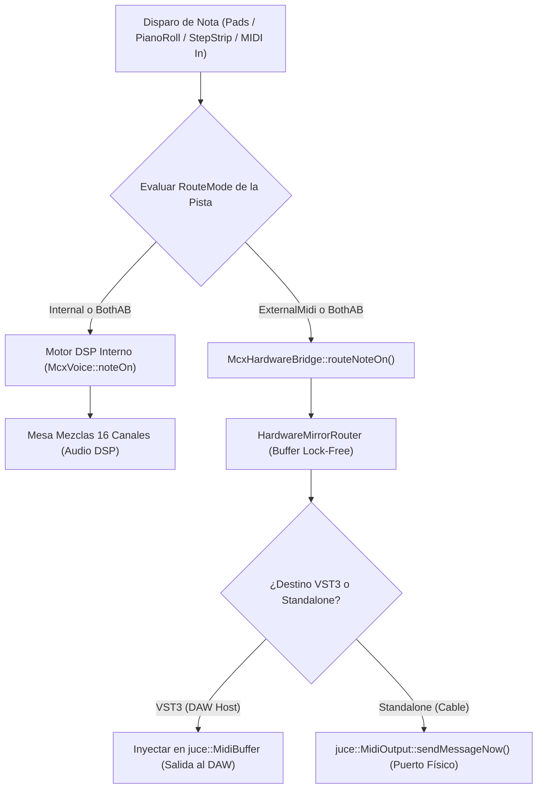

# Arquitectura de Integración Detallada: Workstation Aséptica y Ruteo MIDI Out

> **Documento de Especificación Técnica y Diseño:** Bajada a nivel de ingeniería para la integración de las piezas existentes en `ABDMCX0X` y `ABDShared`.  
> **Estado:** Aprobado para diseño (v1.0 — 2026-11-18).  
> **Ámbito:** Desacoplamiento de las dos naturalezas (Groovebox vs. Rompler), ruteo MIDI Out por contratos y orquestación de eventos.

---

## 1. La Doble Naturaleza: Desacoplamiento Conceptual y Técnico

El sistema se estructura en dos capas independientes con contratos limpios entre sí:

```text
┌─────────────────────────────────────────────────────────────────────────────┐
│                 CAPA 1: WORKSTATION / GROOVEBOX ASÉPTICA                    │
│                                                                             │
│  • Transporte Autónomo (Play, Stop, Rec, BPM, Metrónomo WebAudio)           │
│  • Secuenciador Piano-Roll PPQ (Notas, Duración, Acentos >100, P-Locks)    │
│  • Tira Hardware 16 Pasos (Chaser, Mutes, Acento, Slide)                   │
│  • Matriz de Pads MPC (Ritmo, Cromático In-Key, 16-Levels)                 │
│  • Consola Mezclador 16 Canales Full-Height (Faders, Vúmetros, Sends, Pan) │
│  • Motor Universal de Groove & Shuffle (MPC, TR-909, SP-1200, Triplet, Dilla)│
└──────────────────────────────────────┬──────────────────────────────────────┘
                                       │
            ┌──────────────────────────┴──────────────────────────┐
            ▼                                                     ▼
┌───────────────────────────────────────┐     ┌───────────────────────────────┐
│      CAPA 2A: MOTORES DE SÍNTESIS     │     │     CAPA 2B: CONTROLADOR      │
│     PLUGGABLES (`IMcxSoundEngine`)    │     │     MIDI OUT (HARDWARE/DAW)   │
│                                       │     │                               │
│ • StructuredRomplerEngine (4 Partials)│     │ • HardwareMirrorRouter        │
│ • JunoEngine (DCO + IR3109 + BBD)     │     │ • McxHardwareBridge           │
│ • Ms2000Engine (VA / DWGS)            │     │ • Contratos JSON (*.json)     │
│ • CzEngine (Phase Distortion)         │     │ • Mapeador Semántico CC/NRPN  │
│ • Integración ABDBankManager          │     │ • Cola Lock-Free McxMidiOut   │
└───────────────────────────────────────┘     └───────────────────────────────┘
```

### Reglas de Desacoplamiento:
1. **La Groovebox no asume síntesis:** La Groovebox solo genera eventos musicales `{ tick, note, velocity, durationTicks, semanticParams[] }`. No le importa si quien responde es un motor interno o un sintetizador hardware conectado por cable MIDI.
2. **Los motores no asumen secuenciación:** Todo motor implementa la interfaz pura `IMcxSoundEngine` (`noteOn`, `noteOff`, `setSemanticParam`, `renderBlock`), pudiendo compilarse en plugins VST3 independientes sin arrastrar código de secuenciador ni transporte.
3. **Topología completa sobre bloques sueltos:** Los sintetizadores analógicos emulados (ej. Juno-106 de `ABDJUNiO601`) se reutilizan en su clase de motor completa (`JunoEngine`), preservando sus curvas de calibración, respuesta no-lineal y parches de fábrica, en lugar de reconstruirlos desde bloques genéricos.
4. **Cero impacto en CPU para MIDI Out:** El ruteo a MIDI Out tiene un coste DSP de `0 %` (solo emisión de bytes en colas lock-free), aislando por completo la estabilidad del motor interno.
5. **Descarte de VSTs en pistas:** Para preservar la estabilidad de la sesión y la compatibilidad en WASM, no se hospedan VST3 de terceros; la necesidad de otros sonidos se resuelve con motores de la suite o MIDI Out al DAW/hardware.

---

## 2. Mapa Exhaustivo de Piezas Existentes (El Inventario Real)

Contrario a tener que programar infraestructura desde cero, el repositorio ya cuenta con las piezas críticas construidas:

### A) En el Backend C++ (`ABDMCX0X/Source/`):
| Archivo | Rol Existente | Estado de Preparación |
| :--- | :--- | :--- |
| `DSP/Core/McxTypes.h` | Define `enum class McxPartRouteMode { Internal, ExternalMidi, BothAB }` y `McxPartKind { Chromatic, DrumMap }`. | **100 % listo**. El tipado base ya existe. |
| `MIDI/HardwareMirrorRouter.h` | Formateador lock-free de mensajes MIDI, CCs, tripletas NRPN Roland (CC99 $\to$ CC98 $\to$ CC6) y SysEx `DT1` con checksum 7-bit. | **100 % listo y verificado en tests**. Capacidad para 128 mensajes por bloque. |
| `Hardware/McxHardwareBridge.h` | Puente universal de hardware. Métodos: `routeNoteOn()`, `routeNoteOff()`, `routeSemanticParam()`, `routeDrumSemanticParam()`, carga de perfiles JSON. | **100 % listo**. Falta solo invocarlo desde el bucle de eventos de la Groovebox. |
| `Hardware/McxLatencyCompensator.h` | Buffer circular de retardo para alinear en fase el audio interno con el retardo físico del hardware externo. | **100 % listo**. |
| `MIDI/McxMidiOutQueue.h` | Cola circular lock-free de 1024 eventos para intercambio entre hilos de audio y emisión. | **100 % listo**. |
| `PluginProcessor.cpp` | Declarado con `NEEDS_MIDI_OUTPUT TRUE` en CMake. Su `processBlock` ya recibe `juce::MidiBuffer& midiMessages`. | **Listo**. Falta drenar los mensajes de la cola de salida al buffer del DAW. |

### B) En `ABDShared` (`D:\desarrollos\ABDSynths\ABDShared\`):
| Componente | Ruta | Utilidad Inmediata |
| :--- | :--- | :--- |
| **Detección Hardware** | `Code/HardwareMidiDetect/HardwareMidiDetector.h` | Escaneo de puertos MIDI físicos e identificación automática por SysEx Identity (`F0 7E ... 06 02`). |
| **Registro de Contratos** | `Code/HardwareMidiDetect/HardwareContractRegistry.h` | Almacén en memoria de perfiles hardware disponibles. |
| **Contratos JSON Listos** | `Contracts/*.json` | Perfiles listos: `roland_mc303.json`, `boss_dr5.json`, `korg_ms2000.json`, `casio_cz101.json`, `roland_d2.json`, `roland_juno106.json`, etc. |
| **Contrato C++ Hydrator** | `Code/SynthCore/HardwareProfileHydrator.h` | Convierte el archivo JSON en la estructura en memoria `UniversalHardwareProfile`. |

### C) En la Interfaz WebUI (`ABDMCX0X/WebUI/`):
| Módulo | Elemento Actual | Modificación Requerida |
| :--- | :--- | :--- |
| `ui/McxMixerConsole.ts` | Botón binario `<button class="mcx-strip-kind-btn">DRM / CHR</button>` en línea 107. | Reemplazar por badge interactivo `INT:CHR`, `INT:DRM`, `EXT:01`, `A+B` que abre el nuevo modal. |
| `ui/McxMixerConsole.ts` | `McxPartUiState` almacena solo `kind: 'chromatic' \| 'drum_map'`. | Extender con campos `{ routeMode, externalPort, externalChannel, profileId }`. |
| `bridge/McxHostBridge.ts` | Expone `setParam(part, id, val)`, `noteOn`, `noteOff`. | Añadir `setPartRouteConfig(partIdx, configDto)`. |

---

## 3. El Modelo Ortogonal: Formato Musical × Destino de Ruteo

La confusión conceptual previa se elimina desacoplando las dos dimensiones:

$$\text{Pista} = \text{Formato Musical} \times \text{Destino de Ruteo}$$

### Matriz de Combinaciones Posibles:

| Destino (`RouteMode`) | Formato: `Chromatic` | Formato: `DrumMap` |
| :--- | :--- | :--- |
| **`Internal`** (Solo Rompler) | **`INT:CHR`** — Sintetizador melódico interno (bajo, lead, pad). Teclado cromático, escalas, piano-roll estándar. | **`INT:DRM`** — Batería interna (Drum Kit Rompler). Pads MPC con nombres de sample, TR-REC, choke groups. |
| **`ExternalMidi`** (Solo Hardware/DAW) | **`EXT:CHR`** — Dispara sinte hardware melódico (ej. Korg MS2000, Roland Juno). Envía notas MIDI y CCs/NRPNs según contrato. | **`EXT:DRM`** — Dispara caja de ritmos externa (ej. Roland TR-8S, TR-909). Mapea nombres de pads externos y Drum Key NRPNs. |
| **`BothAB`** (Capa Layer Dual) | **`A+B:CHR`** — Doble capa al unísono: suena el rompler interno y simultáneamente engorda con el sinte externo. | **`A+B:DRM`** — Capa de batería combinada: dispara el bombo interno y a la vez el módulo hardware. |

### Definición de Tipos en TypeScript (`McxPartRouteDto`):
```typescript
export type McxPartRouteMode = 'internal' | 'external' | 'both';
export type McxPartMusicalKind = 'chromatic' | 'drum_map';

export interface McxPartRouteConfig {
  partIndex: number;              // 0..15
  routeMode: McxPartRouteMode;    // 'internal' | 'external' | 'both'
  musicalKind: McxPartMusicalKind;// 'chromatic' | 'drum_map'
  midiChannel: number;            // 1..16
  midiPortId: string;             // 'daw_out' o ID del puerto físico USB/DIN
  hardwareProfileId: string;      // ej: 'roland_mc303', 'korg_ms2000', 'generic_cc'
}
```

---

## 4. Ciclo de Vida de los Eventos y Adaptadores

### A) Pipeline de Notas (Teclado, Pads, Piano-Roll, Secuenciador):
Cuando se produce un disparo de nota `{ note: 60, velocity: 0.85 }` en la pista `p`:



### B) Pipeline de Parámetros Semánticos (Cutoff, Reso, Attack, Decay, Level, Pan):
Los mandos de la interfaz (`McxToneDrawer`, macros, faders de consola) controlan conceptos abstractos normalizados ($0.0 \dots 1.0$).
Cuando el usuario mueve el potenciómetro de **Cutoff**:

1. Si la pista está en **`Internal`**:
   $$\text{cutoffNormalized} \longrightarrow \text{McxFilterBank::setCutoff(Hz)}$$
2. Si la pista está en **`ExternalMidi`**:
   * Consulta el contrato activo (`UniversalHardwareProfile`).
   * Si el perfil define `FilterCutoff` como **CC 74**:
     $$\text{emitCc}(channel, 74, \text{round}(val \times 127))$$
   * Si el perfil es un Roland GS/MC que usa **NRPN**:
     $$\text{emitNrpn}(channel, \text{MSB: } 0x01, \text{LSB: } 0x20, \text{Data: } \text{round}(val \times 127))$$
     *(Emitiendo estrictamente CC99 $\to$ CC98 $\to$ CC6 en orden seguro).*
   * Si es una pista **`DrumMap`** y se edita el pitch de un sonido concreto (ej. Bombo / nota 36):
     $$\text{emitDrumKeyNrpn}(channel, \text{MSB: } 0x18, \text{Key: } 36, \text{Data: } val)$$
3. Si la pista está en **`BothAB`**:
   Aplica ambas rutas simultáneamente, sincronizando el cambio tímbrico en el motor interno y en el hardware físico.

### C) Sincronización de Transporte y Reloj (Clock Out):
Cuando la barra de transporte (`CompactTransportBar`) arranca o se detiene:
* **Play:** Emite mensaje `0xFA` (MIDI Start) o `0xFB` (MIDI Continue) + tren de pulsos `0xF8` (MIDI Clock a 24 PPQ).
* **Stop:** Emite mensaje `0xFC` (MIDI Stop).
* **Song Position:** Emite `0xF2` (Song Position Pointer) al saltar a un compás específico en el secuenciador.

---

## 5. Diseño de Interfaz de Usuario (UI / UX)

### A) El Nuevo Badge en la Tira del Mezclador (`McxMixerConsole.ts`):
Se sustituye el botón plano actual por un indicador de dos líneas compacto:

```text
┌─────────────────┐
│     P 0 1       │
│  [●] LED VOZ    │
├─────────────────┤
│ ┌─────────────┐ │
│ │  I N T      │ │  <-- Línea 1: Destino (INT, EXT, A+B)
│ │  C H R      │ │  <-- Línea 2: Formato (CHR, DRM)
│ └─────────────┘ │
│ (Click: Abre    │
│  Modal Ruteo)   │
├─────────────────┤
│ [ TONE ] [PADS] │
│ ...             │
```

* Variantes visuales del Badge:
  * `INT` + `CHR`: Fondo panel neutro, texto cyan.
  * `INT` + `DRM`: Fondo panel neutro, texto naranja.
  * `EXT` + `CHR`: Fondo acento azul tenue, texto blanco (indica hardware/externo).
  * `EXT` + `DRM`: Fondo acento violeta tenue, texto blanco.
  * `A+B` + `CHR` / `DRM`: Borde doble iluminado (modo layer activo).

---

### B) Especificación y Wireframe del Modal: `McxInstrumentRouteModal`

Al hacer clic en el badge del canal, se despliega una modal compacta, limpia y modeless (o centrada):

```text
┌────────────────────────────────────────────────────────────────────────┐
│  ASIGNACIÓN DE INSTRUMENTO & RUTEO — PISTA 03                   [ ✕ ] │
├────────────────────────────────────────────────────────────────────────┤
│ 1. FORMATO MUSICAL (Organización de Notas):                           │
│    [ (•) Cromático (Melodías / Acordes) ]   [ ( ) Drum Map (Kits) ]    │
│                                                                        │
│ 2. DESTINO DE LA SEÑAL:                                               │
│    ┌───────────────┬────────────────────────┬──────────────────────┐   │
│    │ (•) INTERNO   │ ( ) EXTERNO (MIDI OUT) │ ( ) AMBOS (LAYER A+B)│   │
│    └───────────────┴────────────────────────┴──────────────────────┘   │
├────────────────────────────────────────────────────────────────────────┤
│ CONFIGURACIÓN DEL DESTINO:                                             │
│                                                                        │
│ [Si está en INTERNO o AMBOS]                                           │
│   Motor de Síntesis: [ MCX 4-Partial Structured Rompler v1        ▼ ]  │
│   Preset Asignado:   [ "034: Juno Warm Pad"                      [B] ] │
│                                                                        │
│ [Si está en EXTERNO o AMBOS]                                           │
│   Puerto de Salida:  [ USB MIDI Interface Out 1 (Puerto Físico)   ▼ ]  │
│   Canal MIDI Out:    [ Canal 03                                   ▼ ]  │
│   Perfil Hardware:   [ Roland MC-303 (Auto-detectado)             ▼ ]  │
│                      *(Carga controles CC/NRPN del contrato JSON)*     │
│   Compensación Delay:[ 12 ms ] (Compensa latencia física de cable)     │
├────────────────────────────────────────────────────────────────────────┤
│  [ Probar Sonido (Audition) ]                     [ Aplicar y Cerrar ] │
└────────────────────────────────────────────────────────────────────────┘
```

---

## 6. Plan de Ruta de Integración por Fases (Paso a Paso Seguro)

Para proceder de forma metódica sin romper el audio ni la estabilidad:

### Fase 1: Ruteo de Notas y Selección Visual en UI (Próximo Sprint)
1. Extender `McxPartUiState` con `routeMode`, `externalChannel`, `externalPortId`, `hardwareProfileId`.
2. Crear el componente modal `McxInstrumentRouteModal` en `ABDMCX0X/WebUI/src/ui/`.
3. Actualizar la tira en `McxMixerConsole.ts` para mostrar el badge `INT:CHR`, `INT:DRM`, `EXT:xx`, `A+B`.
4. Conectar `McxHostBridge` para enviar la configuración al backend C++ (`engine_.setPartRouteMode(...)`).

### Fase 2: Cableado del Hilo de Audio y Salida MIDI (C++)
1. En `PluginProcessor.cpp`:
   * Si la pista tiene `routeMode == ExternalMidi` o `BothAB`, cuando el secuenciador o la UI generen notas, invocar `hardwareBridge_.routeNoteOn()` / `routeNoteOff()`.
2. Drenar la cola `hardwareBridge_.getOutboundQueue()` dentro de `midiMessages` en `processBlock` (para que el DAW reciba las notas en VST3) o enviarlas al dispositivo MIDI activo en Standalone.

### Fase 3: Mapeo de Mandos Semánticos con Contratos JSON
1. Enlazar `McxToneDrawer`: cuando el usuario gire Cutoff o Resonance en una pista con `ExternalMidi`, llamar a `hardwareBridge_.routeSynthFilter()`.
2. Verificar con perfiles reales de `ABDShared/Contracts/` (`roland_mc303.json`, `boss_dr5.json`) que se emiten las tripletas NRPN y CCs correspondientes.

### Fase 4: MIDI Clock y Automatización de Secuencias
1. Vincular el avance del `CompactTransportBar` para emitir MIDI Clock (`0xF8`) si la opción de sincronización externa está habilitada.
2. Permitir que el Piano Roll emita P-Locks grabados hacia los sintes externos.
