# Plan Maestro de Arquitectura, Diagnóstico Integral y Hoja de Ruta — ABDMCX0X

> **Propósito:** Consolidar la auditoría arquitectónica de "ojos frescos" sobre `ABDMCX0X` en su transición a **Chasis Host Multi-Motor (`IMcxSoundEngine`) y Secuenciador Central de Estudio/Directo con salida MIDI Out por Contratos**, separando rigurosamente:
> 1. **Problemas Técnicos y de Core** (bugs ocultos, RT-safety, concurrencia, compatibilidad Headless/WASM).
> 2. **Carencias Estructurales y de Infraestructura** (piezas faltantes en C++ y contratos).
> 3. **Problemas de UX, Ergonomía (1280×720 / 10") y Deuda Frontend** (donde gozamos de libertad creativa total para rediseñar vistas).
>
> **Estrategia Rectora y Priorización Acordada:** Acometer **primero el blindaje técnico de la pieza central de la Groovebox en C++20** (manteniendo `kNumParts = 16` retrocompatible con los 6 tests unitarios actuales, pero preparando estructuras y colas indexadas por `partIdx` para escalar sin fricción), seguido por el secuenciador PPQ nativo en C++, después el aislamiento del `StructuredRomplerEngine`, más adelante el diseño específico del **Modo Canción, arquitectura definitiva de múltiples pistas y rediseño WebUI**, y finalmente la integración de `JunoEngine` y demás motores de la suite.  
> **Última actualización:** 2026-11-19

---

## 1. Taxonomía de Hallazgos: Core vs. Carencias vs. UX

> [!NOTE]
> **Estado de Alcance Temporal:**
> - La integración de **`JunoEngine`** queda explícitamente **aplazada a la Fase 5**, una vez blindada la Groovebox central y aislado el `StructuredRomplerEngine` detrás de `IMcxSoundEngine`.
> - El diseño definitivo del **Modo Canción (Song Mode)**, la **arquitectura de múltiples pistas/bancos (ej. 64 pistas)** y las **nuevas vistas WebUI** se abordarán en su sesión dedicada (**Fase 4**). No obstante, la **Fase 1** ya deja la infraestructura C++ preparada (comandos por `partIdx`, multi-puerto/multi-contrato y telemetría dual) para soportarlo limpiamente.

```mermaid
flowchart TD
    Audit["Auditoría Integral ABDMCX0X"] --> B1["BLOQUE I: Problemas Técnicos & Core C++"]
    Audit --> B2["BLOQUE II: Carencias de Infraestructura"]
    Audit --> B3["BLOQUE III: UX, Ergonomía 10p y Deuda WebUI"]

    B1 --> B1A["Bugs MIDI Out: Sin NoteOn/Off, Doble Cola, Rebote MIDI en DAW"]
    B1 --> B1B["RT-Safety: sendMessageNow en Audio Thread, Data Races UI->DSP"]
    B1 --> B1C["Notas Colgadas por Transposición y Pérdida de partIdx en Bridge"]
    B1 --> B1D["Incompatibilidad JUCE en JunoEngine vs Headless/WASM (Fase 5)"]

    B2 --> B2A["Pieza Central Groovebox: Secuenciador PPQ C++ + MIDI Clock 0xF8"]
    B2 --> B2B["Multi-Puerto y Multi-Contrato por Pista + Diezmador NRPN"]
    B2 --> B2C["Aislamiento Rompler: IMcxSoundEngine + McxRomplerVoicePool (Fase 3)"]
    B2 --> B2D["Diseño Pendiente: Modo Canción y Múltiples Pistas/Bancos (Fase 4)"]

    B3 --> B3A["Ancho Físico de Tira (72px) vs Botones Táctiles >= 44px"]
    B3 --> B3B["Cajón Inferior de 4 Pestañas en Flujo de Señal (incl. MIDI FX)"]
    B3 --> B3C["Visibilidad Transversal en Bancos (SOLO Fantasma y LEDs)"]
    B3 --> B3D["Modularización de mcx0x.css (2574 líneas) y main.ts (< 200 líneas)"]
```

---

## 2. BLOQUE I — Problemas Técnicos y de Core (Bugs Ocultos, RT-Safety y Portabilidad)

Son defectos técnicos en el código actual o riesgos directos de tiempo real que deben corregirse en la base C++ antes de escalar el producto:

### I.1. Cinco Fallos en la Tubería de Eventos y MIDI Out
1. **MIDI Out Fantasma en Notas ([McxEngineControl.cpp](file:///d:/desarrollos/ABDSynths/ABDMCX0X/Source/DSP/Core/McxEngineControl.cpp#L84-L129)):** `triggerNote()` emite parámetros NRPN cuando `routesToExternal` es verdadero, pero jamás emite `0x90 NoteOn`; `releaseNote()` ignora por completo las pistas externas y jamás emite `0x80 NoteOff`.
2. **Doble Cola Desconectada ([McxEngine.h](file:///d:/desarrollos/ABDSynths/ABDMCX0X/Source/DSP/Core/McxEngine.h#L235) vs. [PluginProcessor.cpp](file:///d:/desarrollos/ABDSynths/ABDMCX0X/Source/Plugin/PluginProcessor.cpp#L125-L132)):** `McxEngine` escribe en su miembro privado `mirrorRouter_`, mientras que `PluginProcessor::processBlock` drena `hardwareBridge_.getOutboundQueue()`. Ningún puente une ambas colas.
3. **Rebote / Bucle Infinito de MIDI In $\to$ MIDI Out en VST3 ([PluginProcessor.cpp](file:///d:/desarrollos/ABDSynths/ABDMCX0X/Source/Plugin/PluginProcessor.cpp#L70-L132)):** En JUCE, `juce::MidiBuffer& midiMessages` es simultáneamente el buffer de entrada y el de salida al host. Tras leer los eventos entrantes del DAW y del `uiMidiCollector_` (líneas 81–93), **falta invocar `midiMessages.clear()`** antes de inyectar la cola de salida (línea 127). Todo el MIDI entrante rebota duplicado hacia la salida del plugin.
4. **Pérdida de `partIdx` y Colisión de Canales ([PluginProcessor.cpp](file:///d:/desarrollos/ABDSynths/ABDMCX0X/Source/Plugin/PluginProcessor.cpp#L135-L147) y [WasmBridge.cpp](file:///d:/desarrollos/ABDSynths/ABDMCX0X/Source/Wasm/WasmBridge.cpp#L47-L57)):** El disparo desde UI convierte `partIdx` a `midiChannel (1..16)` y llama a `routeMidiChannelNoteOn`. Si dos pistas comparten canal MIDI o al expandir en el futuro a más de 16 pistas (Bancos A..D), tocar en una pista dispara por colisión la otra pista.
5. **Arpegiador Acoplado a Voces Internas ([McxEngine.cpp](file:///d:/desarrollos/ABDSynths/ABDMCX0X/Source/DSP/Core/McxEngine.cpp#L86-L96)):** `p.arp.generate(...)` invoca `triggerInternalVoice` directamente, ignorando `p.routeMode`. En una pista `ExternalMidi`, el arpegiador hace sonar el Rompler interno en vez del sintetizador hardware.

### I.2. Bug de Notas Colgadas (*Hanging Notes*) al Transponer en Vivo
* **Ubicación:** [McxEngineAllocation.cpp](file:///d:/desarrollos/ABDSynths/ABDMCX0X/Source/DSP/Core/McxEngineAllocation.cpp#L170-L202).
* **Causa:** `routeMidiChannelNoteOff` vuelve a calcular `transposer_.processNote(note)`. Si el usuario pulsa un acorde, cambia la Transposición Global o la Escala y luego suelta las teclas, el `NoteOff` se emite para otra nota distinta, dejando las voces internas y los sintes MIDI externos colgados indefinidamente.
* **Solución Core:** Tabla estática por pista `std::array<std::int8_t, 128> latchedNoteMap_` que registra la nota exacta disparada en el `NoteOn` y la recupera en `O(1)` durante el `NoteOff`.

### I.3. Riesgos Severos de RT-Safety y Concurrencia
1. **Mutación sin sincronización UI $\to$ Audio ([PluginEditor.cpp](file:///d:/desarrollos/ABDSynths/ABDMCX0X/Source/Plugin/PluginEditor.cpp#L216-L227)):** `handleJsEvent` ejecuta `applyWebParam` en el hilo de mensajes mutando structs internos de `McxEngine` mientras `processBlock` los lee en el hilo de audio.
2. **Prohibición de `juce::MidiOutput::sendMessageNow()` en el Hilo de Audio:** El envío directo a puertos MIDI físicos del SO (`winmm` / `CoreMIDI` / `ALSA`) adquiere mutexes del kernel. En modo Standalone, el hilo de audio solo puede empujar en colas SPSC lock-free drenadas por un hilo MIDI Out dedicado de alta prioridad.
3. **Prohibición de `std::make_unique` en Caliente para Motores (relevante en Fases 3 y 5):** Cambiar `engineSlots_[p]` destruyendo o reservando memoria dinámica mientras corre `processAudio` viola el contrato *zero-alloc* y produce *Undefined Behavior*. Los motores futuros deberán vivir pre-alojados en pools estáticos desde `prepare()`.

### I.4. Fricción de Portabilidad Headless/WASM al Integrar `JunoEngine` *(Diferido a Fase 5)*
* **Evidencia:** `ABDMCX0X_Core` ([CMakeLists.txt](file:///d:/desarrollos/ABDSynths/ABDMCX0X/CMakeLists.txt#L87-L98) y [DspSources.cmake](file:///d:/desarrollos/ABDSynths/ABDMCX0X/DspSources.cmake)) es **100 % JUCE-free** para compilar en Emscripten WASM y en los tests nativos ligeros. En cambio, [JunoEngine.h](file:///d:/desarrollos/ABDSynths/ABDJUNiO601/Source/Core/JunoEngine.h#L11-L122) incluye `<JuceHeader.h>` (`juce::AudioBuffer`, `ProcessorDuplicator`, `LinearSmoothedValue`, `juce::Random`), inyecta ruido analógico continuo en reposo (violando `maxSilent == 0.0f` de [McxPhase0Tests.cpp](file:///d:/desarrollos/ABDSynths/ABDMCX0X/Tests/McxPhase0Tests.cpp#L66)) y requiere una instancia válida de `CalibrationSettings` para que el filtro IR3109 no quede bloqueado a `1000 Hz`.
* **Solución en Fase 5:** Aislar esas 4 utilidades triviales con primitivas C++20 de `ABDShared`, embeber su calibración por defecto en el adaptador e implementar *auto-sleep* cuando no queden voces activas ni cola en el Chorus BBD.

### I.5. Destrucción de Presets Multicapa por Parámetros Absolutos
* **Evidencia:** [McxParamRouter.h](file:///d:/desarrollos/ABDSynths/ABDMCX0X/Source/Core/McxParamRouter.h#L25-L60) machaca con el mismo valor los 4 parciales del Rompler al mover Cutoff o ADSR general (`for (auto& partial : p.partials)`), arruinando parches donde cada parcial tiene su propia envolvente `4T4L`.
* **Solución Core:** Introducir `McxTrackSemanticOffsets` (macros bipolares no-destructivos) sobre los controles de pista antes de aislar el Rompler.

---

## 3. BLOQUE II — Carencias de Infraestructura y Funcionalidad (Gaps del Sistema)

Son las piezas arquitectónicas nuevas que debemos construir o diseñar en el Core siguiendo el orden acordado:

| ID | Carencia Detectada | Impacto Actual | Solución y Fase Asignada |
| :--- | :--- | :--- | :--- |
| **C1** | **Sin Multi-Puerto ni Multi-Contrato por Pista** | [McxMidiOutMessage](file:///d:/desarrollos/ABDSynths/ABDMCX0X/Source/DSP/Core/McxTypes.h#L211-L216) no tiene `portIndex` y solo admite 16 bytes. [McxHardwareBridge.h](file:///d:/desarrollos/ABDSynths/ABDMCX0X/Source/Hardware/McxHardwareBridge.h#L117) tiene un único `profile_` global para todas las pistas. | **Fase 1:** Ampliar `McxMidiOutMessage` a `{ portIndex, priority, length, bytes[32], sampleOffset }` POD y dotar a `McxHardwareBridge` de `partProfileIdx_[]` + `partPortIdx_[]`. |
| **C2** | **Sin Diezmador MIDI ni Protección NRPN** | 4 LFOs enviando tripletas NRPN (9 bytes c/u) a tasa de control colapsan los `3.125 B/s` de un cable MIDI DIN-5, retrasando las notas musicales. | **Fase 1:** Módulo `McxMidiModDecimator`: límite adaptativo (`35 Hz` CC / `18 Hz` NRPN), umbral $\Delta \ge 1$, **caché de dirección activa NRPN (`CC99/CC98`)** (baja de 9 a 3 bytes por paso) y *backpressure* que prioriza `Clock > Notas > Modulación`. |
| **C3** | **Compensación de Latencia Rígida y Telemetría Audio-Only** | [McxLatencyCompensator.h](file:///d:/desarrollos/ABDSynths/ABDMCX0X/Source/Hardware/McxLatencyCompensator.h) retrasa todo el bus Master (latencia en vivo al tocar internos) y no informa al DAW con `setLatencySamples()`. Las pistas `EXT` marcan `0` en vúmetros. | **Fase 1:** Añadir modo `liveZeroLatency` + `setLatencySamples()` en `PluginProcessor` y telemetría dual (`partPeaks_` audio + `partMidiPeaks_` actividad/velocidad MIDI). |
| **C4** | **Secuenciador PPQ ausente en C++ + Sin MIDI Clock (`0xF8`)** | Las secuencias viven hoy en JS ([main.ts](file:///d:/desarrollos/ABDSynths/ABDMCX0X/WebUI/src/main.ts#L458-L494)). Si cierras la ventana del VST3, el secuenciador se para; hay jitter de `5–20 ms`, no funciona en *offline bounce* y no emite `0xF8`/`0xFA`/`0xFC`. | **Fase 2:** Motor `McxPatternSequencer` C++20 RT-safe en `ABDMCX0X_Core` (doble buffer lock-free, `sampleOffset`, P-Locks, `GrooveShuffleEngine`) + emisor sample-accurate `0xF8` a 24 PPQ. |
| **C5** | **Falta interfaz `IMcxSoundEngine` y Pool Compartido Rompler** | Voces soldadas a `voices_[64]` en `McxEngine`. Impide aislar el Rompler como instrumento autónomo de la suite y preparar el chasis multi-motor. | **✅ Fase 3 (Completado):** `ISoundEngine.h`, `TrackModRouter.h`, `RomplerVoicePool` y `StructuredRomplerEngine` en `ABDShared/Code/SynthEngines/` conectados al chasis polimórfico `McxEngine`. |
| **C6** | **Diseño Pendiente: Modo Canción y Múltiples Pistas/Bancos** | Aún falta diseñar el modelo definitivo de **Song Mode** (escenas/bloques/transiciones) y cómo organizar/escalar las pistas más allá de las 16 actuales (ej. 64 pistas en 4 bancos), además de armonizar `BRIEF_9_DECISIONES.md` y `VISION_GROOVEBOX_16P.md`. | **Fase 4:** Sesión dedicada de diseño de producto y arquitectura de Modo Canción + Múltiples Pistas, seguida de su implementación en Core y WebUI. |
| **C7** | **Motores Adicionales de la Suite (`JunoEngine`, etc.)** | `JunoEngine` depende de utilidades JUCE y carece de *auto-sleep* y pool estático para runtime RT. | **Fase 5:** Desacoplar utilidades JUCE de `JunoEngine` y enchufarlo junto a futuros motores mediante `IMcxSoundEngine` y `StaticHeavyEnginePool`. |

---

## 4. BLOQUE III — Problemas de UX, Ergonomía (1280×720 / 10") y Deuda Frontend

En la capa WebUI tenemos **libertad total de diseño** para crear nuevas vistas o remodelar las actuales cuando lleguemos a la **Fase 4**, siempre respetando `< 200` líneas por archivo TS/JS/CSS y 100 % tokens CSS:

1. **Cuello de Botella Geométrico en la Tira de Consola (`~72 px` de ancho útil):**
   - Meter 3 o 4 botones horizontales dentro de una tira de `72 px` deja áreas táctiles de `~16 px`, imposibles de usar en una tablet de 10" (mínimo recomendado: `44×44 px`).
   - **Rediseño libre previsto:** Simplificar la botonera de cada tira a lanzadores amplios y legibles (`[ EDIT ]`, `[ PADS ]`, `[ SEQ ]`) más el nuevo **Badge de Ruteo/Motor** que abre `McxInstrumentRouteModal`.
2. **Evolución de la Tríada a 4 Pestañas en Flujo de Señal dentro del Cajón Inferior:**
   - Al abrir `[ EDIT ]`, la cabecera del cajón inferior presenta pestañas grandes (`>= 44 px` de alto) siguiendo de izquierda a derecha el camino real de la señal:
     $$\text{\tt [ 1. TRACK ]} \longrightarrow \text{\tt [ 2. MIDI FX ]} \longrightarrow \text{\tt [ 3. ENGINE ]} \longrightarrow \text{\tt [ 4. CH AUDIO ]}$$
   - Da hogar propio a los **Efectos MIDI** (Arpegiador, Chords, Scale, Note Repeat), mantiene `[ TRACK ]` como **Macros Bipolares No-Destructivos** y adapta `[ ENGINE ]` al motor o contrato hardware activo.
3. **Ergonomía de Directo y Visibilidad Transversal en Bancos / Pistas Múltiples:**
   - **Prevención del "SOLO Fantasma":** Botón global destacado `[ SOLO ACTIVE — CLEAR ]` en la barra superior cuando cualquier pista tenga `Solo` activo, aunque pertenezca a un banco oculto.
   - **Telemetría en Pestañas de Banco y Vúmetros Duales:** Micro-LED de actividad + punto `Solo` por banco, y vúmetros duales (dBFS para audio `INT` / barra de velocidad MIDI para `EXT` / combinado para `A+B`).
4. **Saneamiento de Deuda Técnica Frontend:**
   - Trocear el monolito `mcx0x.css` (`2.574` líneas y `39` hexadecimales hardcodeados) en hojas modulares por vista (`< 200` líneas cada una, 100 % variables de `@abdsynths/shared`).
   - Descomponer [main.ts](file:///d:/desarrollos/ABDSynths/ABDMCX0X/WebUI/src/main.ts) (`644` líneas) en controladores cohesivos (`< 200` líneas) y rebajar `McxStepStrip.ts` (`207` $\to$ `< 200` líneas).

---

## 5. Plan Maestro de Ejecución en 5 Fases (Prioridad Absoluta: Pieza Central Groovebox Primero)

Siguiendo la prioridad acordada —**dejar sólida primero la pieza central de la Groovebox, aislar después el Rompler, diseñar luego Modo Canción/Múltiples Pistas/UX, e integrar al final motores externos de la suite como `JunoEngine`**— el orden de ejecución es:

### Fase 1 (✅ VERIFICADA — `7/7` CTest + Bloque 6 WebUI Completado) — Blindaje Técnico Core C++20 y Saneamiento WebUI (`kNumParts = 16`)
* **Objetivo:** Cero bugs de ruteo MIDI Out, cero data races UI$\to$DSP, cero notas colgadas, base RT-safe multi-puerto/multi-contrato lista, y saneamiento completo de deuda WebUI (`< 200` lín./archivo, 100 % tokens CSS y puente Fase 6), manteniendo `kNumParts = 16` para no alterar ni una sola aserción de los 6 tests existentes.
* **Entregables C++ (`< 300` líneas/archivo, 100 % JUCE-free en `ABDMCX0X_Core`):**
  - [x] Evolucionar `McxMidiOutMessage` (`portIndex`, `priority`, `bytes[32]`) y definir `McxTrackSemanticOffsets` en [McxTypes.h](file:///d:/desarrollos/ABDSynths/ABDMCX0X/Source/DSP/Core/McxTypes.h) (239 lín.).
  - [x] Crear [McxCommandQueue.h](file:///d:/desarrollos/ABDSynths/ABDMCX0X/Source/Core/McxCommandQueue.h) (172 lín.) + extraer [McxApvtsApplier.h](file:///d:/desarrollos/ABDSynths/ABDMCX0X/Source/State/McxApvtsApplier.h) (70 lín.) para cola SPSC lock-free UI $\to$ Audio indexada por `partIdx`, eliminando la conversión a 4 bits de canal MIDI y las mutaciones directas en [PluginProcessor.cpp](file:///d:/desarrollos/ABDSynths/ABDMCX0X/Source/Plugin/PluginProcessor.cpp) (292 lín.) y [WasmBridge.cpp](file:///d:/desarrollos/ABDSynths/ABDMCX0X/Source/Wasm/WasmBridge.cpp) (219 lín.).
  - [x] Cerrar las trampas de eventos/MIDI Out: `makeNoteOn`/`makeNoteOff` + `emitNoteOn`/`emitNoteOff` en [HardwareMirrorRouter.h](file:///d:/desarrollos/ABDSynths/ABDMCX0X/Source/MIDI/HardwareMirrorRouter.h), enlace directo `setOutboundMidiQueue(&outQueue_)` en [McxEngine.h](file:///d:/desarrollos/ABDSynths/ABDMCX0X/Source/DSP/Core/McxEngine.h), **`midiMessages.clear()`** tras leer MIDI In en [PluginProcessor.cpp](file:///d:/desarrollos/ABDSynths/ABDMCX0X/Source/Plugin/PluginProcessor.cpp), redirección de `GrooveArpeggiator` a la ruta completa (`INT`/`EXT`/`BOTH`) en [McxEngine.cpp](file:///d:/desarrollos/ABDSynths/ABDMCX0X/Source/DSP/Core/McxEngine.cpp), y tabla `latchedNoteMap_[128]` por pista en [McxEngineControl.cpp](file:///d:/desarrollos/ABDSynths/ABDMCX0X/Source/DSP/Core/McxEngineControl.cpp) (queda pendiente únicamente aislar un hilo dedicado `MidiOutput` para puertos físicos adicionales en Standalone).
  - [x] Multi-contrato y multi-puerto por pista en [McxHardwareBridge.h](file:///d:/desarrollos/ABDSynths/ABDMCX0X/Source/Hardware/McxHardwareBridge.h) (conservando `setProfileById()` como fallback retrocompatible) + [McxMidiModDecimator.h](file:///d:/desarrollos/ABDSynths/ABDMCX0X/Source/MIDI/McxMidiModDecimator.h) (203 lín., `35 Hz` CC / `18 Hz` NRPN con caché `CC99/CC98` y *backpressure* 75 %).
  - [x] Flag `liveZeroLatency` + `setLatencySamples()` en [McxLatencyCompensator.h](file:///d:/desarrollos/ABDSynths/ABDMCX0X/Source/Hardware/McxLatencyCompensator.h) / [PluginProcessor.cpp](file:///d:/desarrollos/ABDSynths/ABDMCX0X/Source/Plugin/PluginProcessor.cpp) y telemetría dual (`partPeaks_` audio + `partMidiPeaks_` MIDI en [PluginEditor.cpp](file:///d:/desarrollos/ABDSynths/ABDMCX0X/Source/Plugin/PluginEditor.cpp) y [WasmBridge.h](file:///d:/desarrollos/ABDSynths/ABDMCX0X/Source/Wasm/WasmBridge.h)).
* **Hallazgos Adicionales Resueltos de Raíz Durante la Fase 1:**
  | Bug Detectado en Auditoría de Código | Corrección de Raíz Aplicada | Archivo |
  | :--- | :--- | :--- |
  | Doble disparo de notas DAW (`routeMidiChannelNoteOn` + `processInboundMidiBuffer`) | Parámetro `dispatchNotes = false` en el parser inbound desde `processBlock` | [McxHardwareInbound.cpp](file:///d:/desarrollos/ABDSynths/ABDMCX0X/Source/Hardware/McxHardwareInbound.cpp) |
  | Copia con alloc en hilo RT durante autodetección SysEx | Índices atómicos sobre `registry_` (`defaultProfileIdx_`, `partProfileIdx_`), función `noexcept` | [McxHardwareProfiles.cpp](file:///d:/desarrollos/ABDSynths/ABDMCX0X/Source/Hardware/McxHardwareProfiles.cpp) |
  | Estado NRPN inbound único corrompido entre canales | `std::array<McxInboundNrpnState, 16> nrpnStates_` indexado por canal `0..15` | [McxHardwareInbound.cpp](file:///d:/desarrollos/ABDSynths/ABDMCX0X/Source/Hardware/McxHardwareInbound.cpp) |
  | Sobrescritura del estado Biquad del canal R al actualizar EQ | Nuevo `Biquad::copyCoeffsFrom()` preservando memoria `s1`/`s2` de R | [McxChannelStrip.h](file:///d:/desarrollos/ABDSynths/ABDMCX0X/Source/DSP/Synth/McxChannelStrip.h) |
  | Pérdida de `sourceKind` en deserialización de presets | Restauración explícita de `sourceKind` y `midiPortIndex` | [McxBankManagerBridge.cpp](file:///d:/desarrollos/ABDSynths/ABDMCX0X/Source/Core/McxBankManagerBridge.cpp) |
* **Verificación:** [McxPhase0Tests.cpp](file:///d:/desarrollos/ABDSynths/ABDMCX0X/Tests/McxPhase0Tests.cpp)..[McxPhase5Tests.cpp](file:///d:/desarrollos/ABDSynths/ABDMCX0X/Tests/McxPhase5Tests.cpp) intactos y en verde + nuevo [McxPhase6CoreInfraTests.cpp](file:///d:/desarrollos/ABDSynths/ABDMCX0X/Tests/McxPhase6CoreInfraTests.cpp) (294 lín., `18/18` pass incl. Test #8 añadido en Fase 3) registrado en [CMakeLists.txt](file:///d:/desarrollos/ABDSynths/ABDMCX0X/CMakeLists.txt) — **`7/7` suites CTest pasando al 100 %**.

#### Bloque 6 (✅ VERIFICADO) — Limpieza de Deuda Técnica WebUI, Tokenización 100 % y Puente Fase 6
* **Modularización CSS & Tokenización 100 %:** [mcx0x.css](file:///d:/desarrollos/ABDSynths/ABDMCX0X/WebUI/src/styles/mcx0x.css) (2.574 lín. $\to$ manifiesto `@import` de 23 lín.) particionado en **21 hojas CSS modulares** (`mcx-base.css`, `mcx-workspace.css`, `mcx-master-panel.css`, `mcx-master-meter.css`, `mcx-vu-modal.css`, `mcx-mixer-strips.css`, `mcx-strip-controls.css`, `mcx-strip-fader-vu.css`, `mcx-settings-widgets.css`, `mcx-keyboard-dock.css`, `mcx-side-drawers.css`, `mcx-bottom-drawers.css`, `mcx-pads-drawer.css`, `mcx-mpc-matrix.css`, `mcx-tone-decks.css`, `mcx-tone-channel.css`, `mcx-tone-modules.css`, `mcx-segmented.css`, `mcx-lfo-panel.css`, `mcx-lfo-targets.css`, `mcx-sends-panel.css`), todas `< 180` líneas, **0** hex/rgba literales (`CSS_COLOR_HITS=0`) y corrección de 4 tokens obsoletos hacia tokens canónicos de [tokens.css](file:///d:/desarrollos/ABDSynths/ABDShared/Assets/styles/tokens.css). Añadidos estilos `.is-midi-ext` y `.is-midi-mode` con `--color-cable-midi-out`.
* **Descomposición TypeScript (`< 200` líneas) y Puente Fase 6:**
  - [main.ts](file:///d:/desarrollos/ABDSynths/ABDMCX0X/WebUI/src/main.ts) (644 $\to$ 189 lín.) descompuesto en [McxAppState.ts](file:///d:/desarrollos/ABDSynths/ABDMCX0X/WebUI/src/app/McxAppState.ts) (167 lín.), [McxPianoRollSync.ts](file:///d:/desarrollos/ABDSynths/ABDMCX0X/WebUI/src/app/McxPianoRollSync.ts) (54 lín.), [McxModalsFactory.ts](file:///d:/desarrollos/ABDSynths/ABDMCX0X/WebUI/src/app/McxModalsFactory.ts) (196 lín.) y [McxInputAndTelemetry.ts](file:///d:/desarrollos/ABDSynths/ABDMCX0X/WebUI/src/app/McxInputAndTelemetry.ts) (103 lín.); [McxStepStrip.ts](file:///d:/desarrollos/ABDSynths/ABDMCX0X/WebUI/src/ui/McxStepStrip.ts) refactorizado (207 $\to$ 194 lín.) con `buildPadState`, `setBpm()` y `setSwing()`.
  - Extraído [mcxParamIds.ts](file:///d:/desarrollos/ABDSynths/ABDMCX0X/WebUI/src/bridge/mcxParamIds.ts) con IDs `82..89` (`cutoffOffset`..`vibratoOffset` y `partMidiPort`); propagación de `partMidiPeaks` en [McxHostBridge.ts](file:///d:/desarrollos/ABDSynths/ABDMCX0X/WebUI/src/bridge/McxHostBridge.ts), [BridgeWasm.ts](file:///d:/desarrollos/ABDSynths/ABDMCX0X/WebUI/src/bridge/BridgeWasm.ts), [mcx0xWorklet.js](file:///d:/desarrollos/ABDSynths/ABDMCX0X/WebUI/src/wasm/mcx0xWorklet.js) (174 lín., sincronizado con `WebUI/public/wasm/`) y `wasm/CMakeLists.txt`.
  - **4 bugs silenciosos WebUI corregidos de raíz:** vúmetros de consola desconectados (`#mcx-strips` $\to$ `#part-list`) con soporte dual Audio/MIDI en [McxMixerConsole.ts](file:///d:/desarrollos/ABDSynths/ABDMCX0X/WebUI/src/ui/McxMixerConsole.ts); envío indebido de `patternSwing` al índice DSP `0` (`filterCutoff`) en WASM; actualización en vivo real desde Piano Roll vía `McxToneDrawer::updateParamLive()`; y eliminación de llamadas muertas (`selectCenterTab`, `bindVectorPad`).
* **Verificación Bloque 6:** `vite build` limpio en `1.80s` (157 módulos); **0 archivos manuales `>= 200` líneas** (`OVER_200_COUNT=0`); **0 colores hardcodeados** (`CSS_COLOR_HITS=0`, `TS_COLOR_HITS=0`); y **0 errores `tsc`** en todos los módulos creados/refactorizados.

### Fase 2 — Motor Secuenciador PPQ Nativo y MIDI Clock (`0xF8`) en C++20
* **Objetivo:** Completar el corazón de la Groovebox para que el secuenciador sea autónomo (funcione con la ventana VST3 cerrada, en *offline bounce* y sin jitter de JavaScript).
* **Entregables C++ (`< 300` líneas/archivo):**
  1. Integrar y extender de forma DRY el motor ya existente `ABDShared/Code/SynthCore/PatternSequencerEngine.h` dentro de `McxEngine` (ticks `96/480 PPQ`, doble buffer lock-free para edición desde UI, integración con `GrooveShuffleEngine` por parte y Parameter Locks).
  2. Emisor sample-accurate de `0xF8` MIDI Clock (`24 PPQ`), `0xFA` Start, `0xFB` Continue y `0xFC` Stop con prioridad `0` en la cola de salida.

### Fase 3 (✅ VERIFICADA — `14/14` `ABDShared` + `7/7` CTest + `5/5 build.bat full`) — Aislamiento del `StructuredRompler` (`ISoundEngine` & `TrackModRouter`)
* **Objetivo:** Separar limpiamente la naturaleza **Workstation/Groovebox** de su primer motor de sonido (**Structured Rompler**), dejándolo listo para reutilizarse en otros plugins de la suite y preparando el chasis para alojar más motores.
* **Entregables C++ (`< 300` líneas/archivo, 100 % JUCE-free en Core):**
  - [x] Definir [ISoundEngine.h](file:///d:/desarrollos/ABDSynths/ABDShared/Code/SynthEngines/ISoundEngine.h) y [TrackModRouter.h](file:///d:/desarrollos/ABDSynths/ABDShared/Code/SynthEngines/TrackModRouter.h) en `ABDShared/Code/SynthEngines/` (`noexcept`, descubrimiento por `SemanticRoleHash`, `EngineTransportContext`, modulación no destructiva por pista y retorno booleano en `renderBlock` para `0 %` CPU en silencio).
  - [x] Extraer `RomplerVoicePool` compartido en `ABDShared::StructuredRompler` manteniendo el *voice stealing* por presupuesto de parciales (`28`/`64`/`256`) y callback `VoiceStolenFn` hacia `McxEngine::onRomplerVoiceStolen`.
  - [x] Encapsular `StructuredRomplerEngine : public ISoundEngine` (incluyendo `VCF 1 -> VCF 2`, `RomplerBankLoader` y `RomplerFactoryPatches`), conectar slots polimórficos `engineSlots_[16]` en `McxEngine`, retirar `Filter 2` de `McxChannelStrip.h` y eliminar **11 archivos duplicados** (`McxBankLoader.cpp`, `McxFactoryBank.cpp`, `McxRomTables.h`, `McxEnvelope5Stage.*`, `McxFilterBank.*`, `McxPartialExciter.*`, `McxVoice.*`), validado con Test #8 en [McxPhase6CoreInfraTests.cpp](file:///d:/desarrollos/ABDSynths/ABDMCX0X/Tests/McxPhase6CoreInfraTests.cpp) (`18/18` pass), `ABDShared_StructuredRompler_Tests` (`14/14` pass) y `build.bat full nopause` (`5/5`).

### Fase 4 (Diseño Futuro Pendiente) — Modo Canción, Múltiples Pistas y Rediseño UX WebUI
* **Objetivo:** Abordar en una sesión de diseño específica todo lo relativo a composición de canciones, escalado de pistas/bancos y renovación visual/táctil de la WebUI.
* **Alcance:**
  1. **Modo Canción (`Song Mode`):** Diseño de escenas, bloques con repeticiones, máscaras de mute, transposición por bloque y transiciones cuantizadas en `McxPatternSequencer`.
  2. **Arquitectura de Múltiples Pistas / Bancos (ej. 64 pistas en 4 bancos A..D):** Escalado de `kNumParts`, reorganización de pistas, prevención de "SOLO Fantasma" y vúmetros duales.
  3. **Saneamiento y Nuevas Vistas WebUI (`< 200` líneas/archivo, 100 % tokens):** Troceado de `mcx0x.css` y [main.ts](file:///d:/desarrollos/ABDSynths/ABDMCX0X/WebUI/src/main.ts), modal `McxInstrumentRouteModal`, cajón inferior de 4 pestañas (`[ TRACK ] | [ MIDI FX ] | [ ENGINE ] | [ CH AUDIO ]`) y `PianoRollModal` como vista pura sobre el secuenciador C++.

### Fase 5 (Futuro) — Integración Multi-Motor de la Suite (`JunoEngine`, `Ms2000Engine`, `CzEngine`)
* **Objetivo:** Incorporar los sintetizadores de topología completa de `ABDSynths` sobre el chasis Groovebox ya maduro y con el Rompler aislado.
* **Entregables:**
  1. Limpiar las 4 utilidades JUCE de [JunoEngine.h](file:///d:/desarrollos/ABDSynths/ABDJUNiO601/Source/Core/JunoEngine.h) hacia primitivas C++20 de `ABDShared`, añadir *auto-sleep* en reposo y embeber su calibración por defecto.
  2. Crear `StaticHeavyEnginePool` (pool pre-alojado RT-safe sin `new`/`delete` en audio) y adaptadores `JunoEngineAdapter`, `Ms2000EngineAdapter`, etc. sobre `IMcxSoundEngine`.
  3. Vistas específicas en `[ ENGINE ]` de la WebUI (ej. panel dedicado Juno-106 con sus 128 patches de fábrica).
